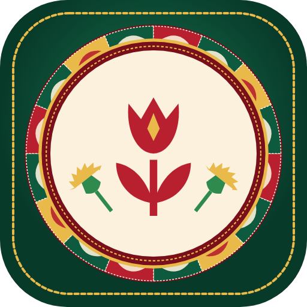
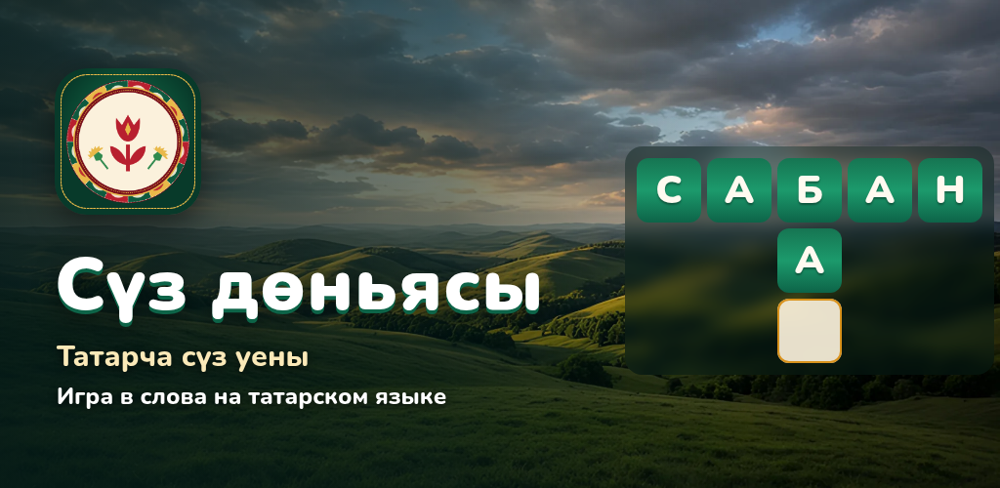
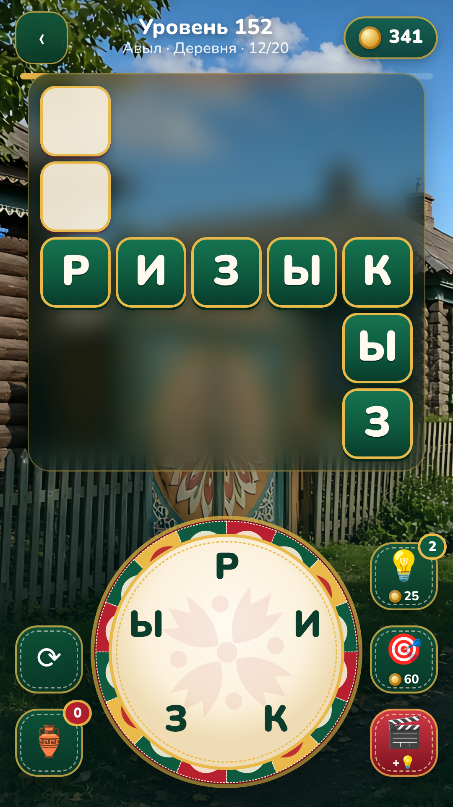
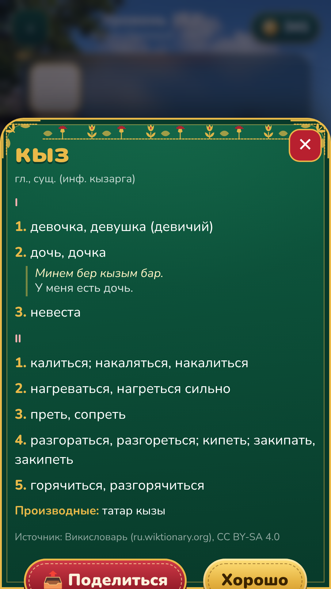
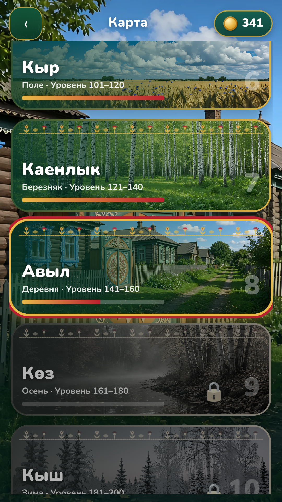
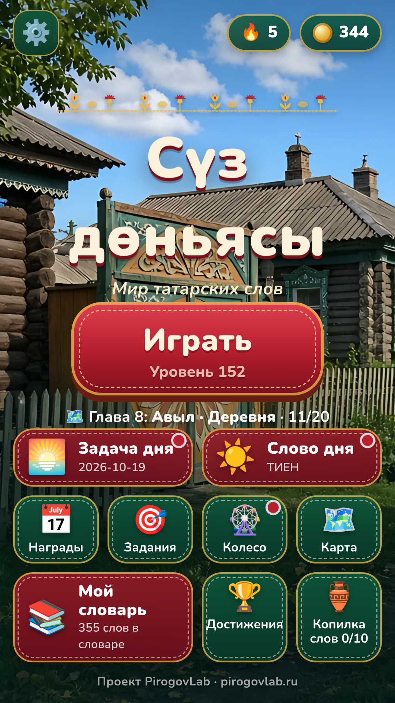

<p align="center"></p>

<h1 align="center">Сүз дөньясы — мир татарских слов</h1>

<p align="center">


<a href="LICENSE"></a>

<a href="https://pirogovlab.ru/suz-donyasy-igra/"></a>
</p>

<p align="center"></p>

**RU** · [EN](#english)

Словесная головоломка на татарском языке: соединяйте буквы на круге, составляйте татарские слова и заполняйте кроссворд. 1000 уровней в 50 главах, карточка с переводом на русский для каждого слова. Работает без интернета.

<!-- PLACEHOLDER store badges: add RuStore / Google Play / Yandex Games links when the listings are live -->
**Играть в браузере:** https://pirogovlab.ru/suz-donyasy/ · **Страница игры:** https://pirogovlab.ru/suz-donyasy-igra/ · **Скачать APK:** https://pirogovlab.ru/suz-donyasy/suz-donyasy.apk

## Возможности
- **1000 уровней в 50 главах** (Болын, Урман, Идел, Чулман, Казан, Сабантуй, Курай, Бизәк…), у каждой главы свой фон.
- Буквы **Ә Ө Ү Җ Ң Һ** прямо на колесе.
- **Карточки слов**: перевод, значения и примеры; «Мой словарь» с выученными словами.
- Задача дня, слово дня, ежедневная награда, задания, колесо удачи, достижения, бонусные слова и копилка.
- Интерактивное обучение; подсказки (буква, слово, перемешать).
- Платформы: веб, Android (WebView + Yandex Mobile Ads), Яндекс Игры (SDK v2).

## Скриншоты
<p>
   
</p>

## Данные
- Слова, переводы и примеры: татарские статьи русского Викисловаря (ru.wiktionary.org) через Wiktextract / kaikki.org, плюс English Wiktionary. Лицензия **CC BY-SA 4.0**, поэтому `data/` распространяется под той же лицензией.
- Частоты слов: татарская Википедия (используются только счётчики).
- Религиозная и ненормативная лексика исключена (`tools/religion_filter.py`, проверка `tools/scan_religion.py`).
- Подробнее: [SOURCES.md](SOURCES.md). Исходные дампы в репозиторий не входят; их скачивает `tools/fetch_sources.sh`.

## Сборка
```bash
python3 tools/build_game.py 1000 20      # data/levels.js + data/cards/  (нужны дампы в src/)
cd test && npm i && node test.js && node test_tutorial.js
python3 tools/build_release.py yandex    # архив для Яндекс Игр
tools/build_android.sh                   # подписанные APK/AAB (JDK 17, Android SDK 36, Gradle 8.13)
```
Ключи подписи хранятся **вне репозитория**: `release/keys/keystore.properties` (в .gitignore), с полями `storeFile`, `storePassword`, `keyAlias`, `keyPassword`. Без них соберётся неподписанный APK.
Рекламные блоки задаются в `android/app/src/main/res/values/ads.xml`.

Структура:
- `index.html`, `css/`, `js/`: игра;
- `data/`: уровни и карточки;
- `img/bg/`: фоны глав;
- `android/`: оболочка;
- `tools/`: сборка данных, фонов, релизов и трейлера;
- `test/`: Playwright-тесты;
- `design/`: иконка и промо-графика;
- `store/`: тексты и скриншоты для магазинов.

## Лицензии
- Код: MIT ([LICENSE](LICENSE)).
- Словарные данные в `data/`: CC BY-SA 4.0 (© авторы Викисловаря).
- Фоны глав (`img/bg/`) — изображения, сгенерированные ИИ. Иконка и графика © PirogovLab.

## Автор
Проект [PirogovLab](https://pirogovlab.ru) — Михаил Пирогов.

---

## English

**Süz Dönyası** (“World of Words”) is a word puzzle in the Tatar language: connect letters on the wheel, build Tatar words and fill the crossword. It has 1000 levels in 50 chapters and a word card with a Russian translation for every word. Works offline. Web, Android (WebView) and Yandex Games builds. Code: MIT; dictionary data: CC BY-SA 4.0 (Wiktionary).
